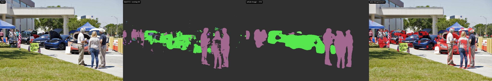

# HiResFlow

**Run existing high-resolution semantic-segmentation models on a single GPU.**

English | [简体中文](README.zh-CN.md)

HiResFlow is a C++ inference runtime for existing FP32 ONNX segmentation
models. It inspects model constraints, plans batch execution against available
VRAM, calibrates throughput on the target GPU, runs tiled inference, merges the
results in source-image coordinates, and emits reproducible reports.

> **Status:** v0.1 technical preview. APIs, CLI options, report schemas, and
> internal interfaces may change.

HiResFlow does not upscale images, generate pixels, train models, or replace
CUDA image-processing libraries. Execution uses ONNX Runtime; image decode and
preprocessing currently run on the CPU.

[Quick start](#build) · [Capabilities](#current-capabilities) ·
[Measured results](#measured-preview) · [Limitations](#project-status-and-known-limitations) ·
[Roadmap](#roadmap)

## Measured preview

On an RTX 5070 Laptop 8 GB, a calibrated FP32 FCN run produced the following
result on a 6720x4480 NASA image:

| Strategy | End-to-end | Classes retained |
|---|---:|---:|
| 512 tiled, 64 overlap | 6.40 s | 18 |
| whole image resized to 512 | 0.30 s | 4 |

The tiled and downscaled masks agreed on 93.66% of pixels. The tiled path
retained substantially more people, vehicles, and small structures, but it is
not an accuracy claim: ground-truth mIoU and seam-aware quality evaluation are
still required.



Sample image credit: NASA/Frank Michaux, image ID
`KSC-20180418-PH_FWM01_0013`. See [`samples/README.md`](samples/README.md).

## Current capabilities

- PNG/JPG image input and PNG mask output.
- ONNX Runtime C++ backend with CUDA Execution Provider and CPU fallback.
- Model metadata discovery for input size, class count, and fixed batch size.
- GPU-budget-aware batch planning with a safety reserve.
- Automatic free-VRAM budget discovery when `--budget-mb` is omitted on CUDA.
- Runtime OOM detection with halving batch fallback.
- Edge-anchored source tiles with configurable overlap.
- Weighted overlap fusion and exact original-size output.
- Whole-image downscaling baseline with agreement and seam diagnostics.
- 8-bit class-index PNG output and mIoU evaluation against index masks.
- Single-image run reports and repeated P50/P95 benchmarks.
- Optional CUDA device-memory sampling through the CUDA runtime.
- Synthetic backend for testing the complete runtime without model weights.

## Build

Validated platform: Linux x86_64 with CMake 3.20+, a C++17 compiler, and
`wget`. CUDA inference requires a compatible NVIDIA driver and CUDA 12 runtime.

Quickstart:

```bash
git clone https://github.com/wl20a/hiresflow.git
cd hiresflow
bash scripts/quickstart.sh
```

The script downloads pinned dependencies and model files, builds, runs tests,
and calibrates/runs a CUDA smoke test when an NVIDIA device is accessible.

Manual build:

```bash
bash scripts/fetch_deps.sh
cmake -S . -B build -DCMAKE_BUILD_TYPE=Release
cmake --build build -j
ctest --test-dir build --output-on-failure
```

The default dependency directory is `work/deps`. It contains ONNX Runtime
1.31.0 for CUDA 12 and the pinned stb image headers. Neither dependency is
committed to the repository.

## Smoke test

The synthetic backend checks tiling, batching, fusion, coordinate mapping, and
reporting without requiring model weights:

```bash
./build/hiresflow run \
  --backend synthetic \
  --input path/to/image.png \
  --output outputs/synthetic-demo.png \
  --input-width 256 \
  --budget-mb 6144
```

## ONNX segmentation

Download the public ONNX Model Zoo FCN ResNet-50 FP32 model:

```bash
bash scripts/fetch_model.sh
```

Run it on the GPU:

```bash
./build/hiresflow run \
  --backend onnx \
  --model work/models/fcn-resnet50-12.onnx \
  --input path/to/large.jpg \
  --output outputs/mask.png \
  --input-width 512 \
  --input-height 512 \
  --classes 21 \
  --budget-mb 6144 \
  --reserve-mb 1024 \
  --index-output outputs/mask.index.png
```

Use `--cpu` to force the ONNX Runtime CPU provider. If CUDA provider creation
fails, the backend falls back to CPU and records the actual provider in the
report.

Inspect model metadata and save the resulting plan without generating a mask:

```bash
./build/hiresflow plan \
  --backend onnx \
  --cpu \
  --model work/models/fcn-resnet50-12.onnx \
  --input path/to/large.jpg \
  --input-width 512 \
  --input-height 512 \
  --budget-mb 6144 \
  --report outputs/plan.json
```

The FCN model has dynamic spatial input dimensions, so `--input-width` and
`--input-height` are required. The model output does have a static class axis,
so `--classes 21` is optional and can be used as an explicit override.

## Benchmark

```bash
./build/hiresflow benchmark \
  --backend onnx \
  --model work/models/fcn-resnet50-12.onnx \
  --input path/to/large.jpg \
  --input-width 512 \
  --input-height 512 \
  --classes 21 \
  --budget-mb 6144 \
  --warmup 3 \
  --repeat 20 \
  --report outputs/benchmark.json
```

The benchmark reports total and inference P50/P95 latency, mean preprocessing
and merge time, the selected plan, and sampled device-memory usage. Device
memory is total GPU usage, not allocator-exact process memory.

Measured host results and optimization history are recorded in
[`docs/benchmarks.md`](docs/benchmarks.md).

## Compare tiled inference with whole-image downscaling

```bash
./build/hiresflow compare \
  --backend onnx \
  --model work/models/fcn-resnet50-12.onnx \
  --input path/to/large.jpg \
  --input-width 512 \
  --input-height 512 \
  --budget-mb 6144 \
  --output outputs/comparison
```

This writes `comparison.tiled.png`, `comparison.downscaled.png`, and
two class-index PNGs, plus `comparison.report.json`. The report includes pixel
agreement, tile-seam label change rate, and non-seam label change rate. These
are consistency diagnostics, not ground-truth mIoU. A mostly uniform image can
produce high agreement while still hiding small-object failures.

The report also records how many semantic classes appear in each output.
Comparisons where either output contains only one class are explicitly marked
as unsuitable for demonstrating segmentation quality.

If the input and ground truth use the same pixel dimensions and the ground
truth is a single-channel index PNG, add:

```bash
--ground-truth path/to/labels.index.png
```

The comparison report then also contains tiled and downscaled mIoU. Palette
ground-truth PNGs are currently rejected because a palette-to-class mapping
must be explicit rather than guessed.

Evaluate existing prediction and ground-truth index masks directly:

```bash
./build/hiresflow evaluate \
  --prediction outputs/mask.index.png \
  --ground-truth path/to/labels.index.png \
  --classes 21 \
  --report outputs/evaluation.json
```

Process a directory with one loaded model session:

```bash
./build/hiresflow run-dir \
  --backend onnx \
  --model work/models/fcn-resnet50-12.onnx \
  --input-dir path/to/images \
  --output-dir outputs/batch \
  --input-width 512 \
  --input-height 512 \
  --budget-mb 6144
```

Each successful image produces a colored mask, an index mask, and an
individual report. Per-image failures are recorded in `summary.json` without
discarding successful results from the rest of the directory.

The host wrapper loads the calibrated model once and prints aggregate P50/P95
after processing a directory:

```bash
bash scripts/host_gpu_batch.sh /path/to/images outputs/my-batch
```

## Python API

The initial Python package is a thin wrapper around the C++ executable:

```python
import hiresflow

report = hiresflow.segment(
    "large.jpg",
    "mask.png",
    "model.onnx",
    input_size=(512, 512),
    classes=21,
    calibration_path="outputs/host-gpu-calibration.conf",
)
print(report["timing_ms"])
```

Set `HIRESFLOW_BIN=/absolute/path/to/hiresflow` if the executable is not at
`build/hiresflow` or on `PATH`.

A runnable example is available at
[`examples/python_segment.py`](examples/python_segment.py).

When an IDE-terminal sandbox cannot expose `/dev/nvidia*`, run the same GPU
smoke test from the normal host terminal:

```bash
bash scripts/host_gpu_smoke.sh /path/to/large-image.jpg
```

Generate an ONNX Runtime operator profile and summarize which execution
provider handled each node:

```bash
HIRESFLOW_PROFILE=1 bash scripts/host_gpu_smoke.sh /path/to/large-image.jpg
bash scripts/summarize_ort_profile.sh hiresflow_ort_profile_*.json
```

Run a repeated host benchmark after the one-shot smoke test:

```bash
bash scripts/host_gpu_benchmark.sh /path/to/large-image.jpg
```

For batch scaling, generate a deterministic 4096x4096 performance fixture and
sweep batch sizes:

```bash
python3 scripts/make_perf_fixture.py
bash scripts/host_gpu_sweep.sh work/samples/perf-4096x4096.png
```

Reports are written to `outputs/batch-sweep/batch-<N>.json`. The fixture is
only for performance testing, not segmentation quality claims.

For a real high-resolution sample, download the attributed NASA Earth Day
image:

```bash
bash scripts/fetch_sample.sh
```

Source and usage notes are in [`samples/README.md`](samples/README.md).

Persist the fastest feasible batch and measured per-sample memory as a
reusable calibration:

```bash
bash scripts/host_gpu_calibrate.sh work/samples/perf-4096x4096.png
```

This writes `outputs/host-gpu-calibration.json` and
`outputs/host-gpu-calibration.conf`. Reuse it in later runs:

```bash
HIRESFLOW_CALIBRATION=outputs/host-gpu-calibration.conf \
  bash scripts/host_gpu_benchmark.sh /path/to/large-image.jpg
```

The calibration is tied to the model file size and execution provider. It must
be regenerated when changing the model, GPU, ONNX Runtime build, or large tile
shape.

Run the calibrated tiled/baseline comparison from the host:

```bash
bash scripts/host_gpu_compare.sh /path/to/large-image.jpg
```

If a single-channel index ground-truth mask is available, pass it as the second
argument to include mIoU for both strategies.

The overlap experiment is controlled by `HIRESFLOW_OVERLAP` for the host
comparison and benchmark scripts. For example:

```bash
HIRESFLOW_REPORT_PREFIX=outputs/nasa-overlap-128 \
HIRESFLOW_OVERLAP=0.25 \
  bash scripts/host_gpu_compare.sh work/samples/nasa/earth-day-2018.jpg
```

Or run both overlap values and print the diagnostic summary:

```bash
bash scripts/host_gpu_overlap_sweep.sh work/samples/nasa/earth-day-2018.jpg
```

## Runtime contract

- Tile and mask coordinates always use the original image coordinate system.
- The output mask has exactly the same width and height as the input.
- Every source pixel must be covered by at least one tile.
- Edge tiles are anchored to the final row and column instead of leaving a
  small residual tile.
- The planner treats GPU reserve as safety headroom, not as permanently
  allocated memory.
- When CUDA is active and no explicit budget is supplied, the planner queries
  current free device memory. The plan records whether the budget was explicit,
  automatically discovered, or a fallback.
- A fixed model batch dimension is a hard planning constraint.
- If the backend reports an OOM, the executor halves the active batch and
  retries. Retry count and the executed batch limit are stored in the report.
- Fusion confidence is a bounded logistic transform of the top-1 versus top-2
  logit margin. It reduces merge cost but is not calibrated model uncertainty.
- The static memory estimate is conservative. Real GPU calibration is still
  required before claiming an optimal plan.
- `--calibrated-sample-mb` accepts an externally measured per-sample working
  set size and replaces the conservative planner estimate for the batch search.

## Project status and known limitations

HiResFlow is an early-stage technical preview, not a production-ready inference
platform. The v0.1 implementation validates the complete semantic-segmentation
workflow, but several important engineering and evaluation tasks remain:

- Single CUDA Stream; CPU preprocessing, merge, and output encoding do not yet
  overlap across images.
- No automatic FP16 or TensorRT execution path.
- GPU decoding and preprocessing are not yet integrated.
- Fusion uses a bounded top-1/top-2 confidence heuristic rather than full
  all-class probability accumulation.
- Only semantic segmentation is implemented; detection and OCR merge adapters
  are not available.
- Synchronized dataset slicing for images, masks, boxes, and keypoints is not
  implemented.
- Linux x86_64 is the only validated platform.
- Python currently wraps the C++ CLI rather than using a native extension.
- Accuracy has not yet been established on a ground-truth annotated
  high-resolution benchmark dataset.
- EXIF image orientation and transparent-background compositing are not fully
  handled.

## Roadmap

1. Reduce large-image tail latency through asynchronous output and pipelined
   CPU/GPU execution.
2. Add FP16 calibration and TensorRT execution-provider experiments.
3. Add GPU decoding and preprocessing using nvImageCodec or CV-CUDA.
4. Improve overlap fusion for multi-class ambiguity.
5. Add synchronized dataset slicing for masks, boxes, and keypoints.
6. Add detection and OCR result-merging adapters.
7. Provide ground-truth high-resolution benchmarks, prebuilt releases,
   containers, and native Python wheels.

## Feedback and contributions

HiResFlow is under active development. I will continue improving execution
efficiency, model compatibility, result quality, packaging, and documentation.
Feedback, bug reports, benchmark reproductions, and pull requests are welcome.
Reports about unsupported ONNX models are especially useful.

When opening an issue, include the GPU model, driver and ONNX Runtime versions,
the full command, the generated JSON report when possible, and a minimal
reproduction that preserves the problem.

See [`CONTRIBUTING.md`](CONTRIBUTING.md) for development and test instructions.

## License

Licensed under the Apache License 2.0. See [`LICENSE`](LICENSE).

Third-party dependencies and sample attribution are documented in
[`THIRD_PARTY_NOTICES.md`](THIRD_PARTY_NOTICES.md).
